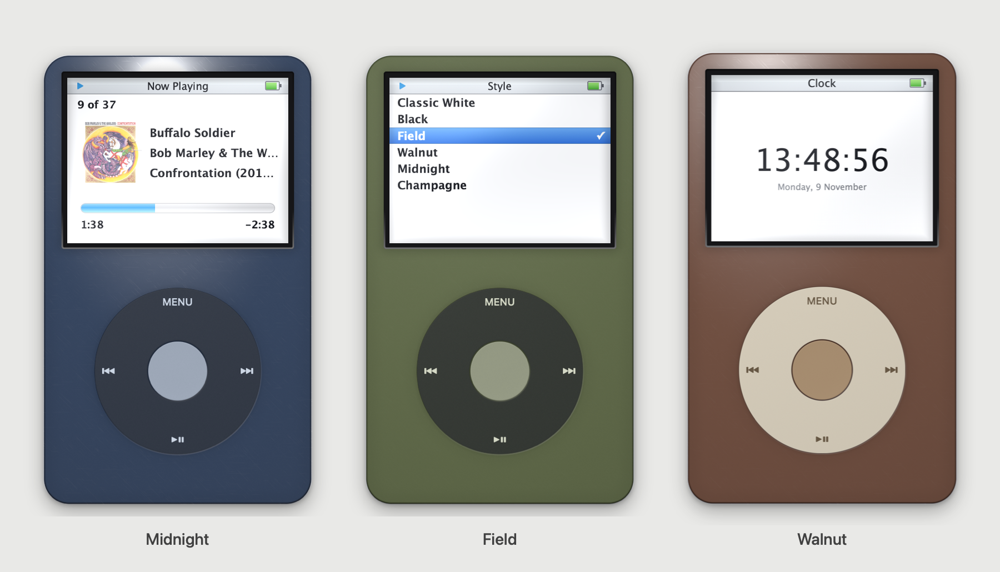
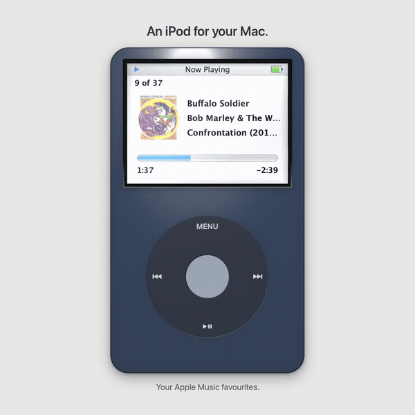
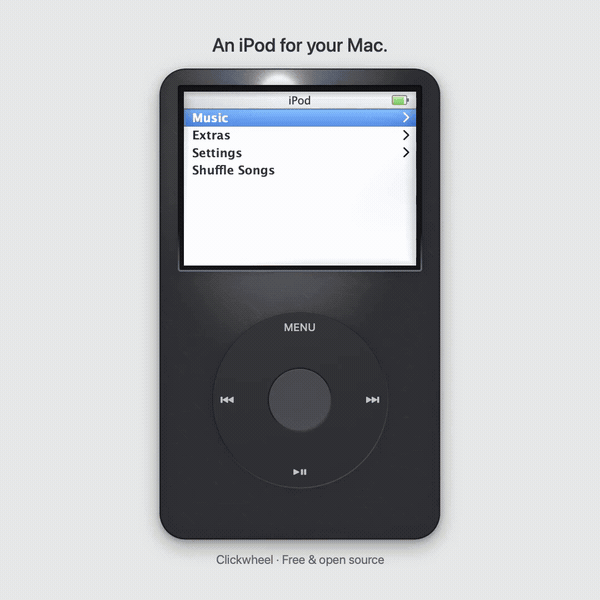
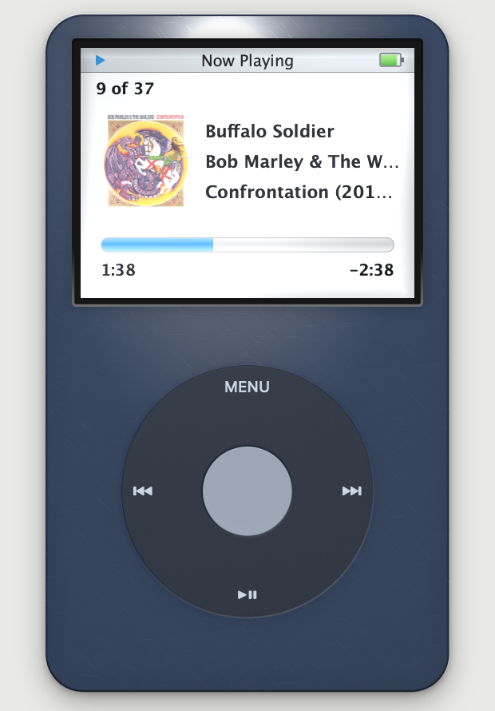
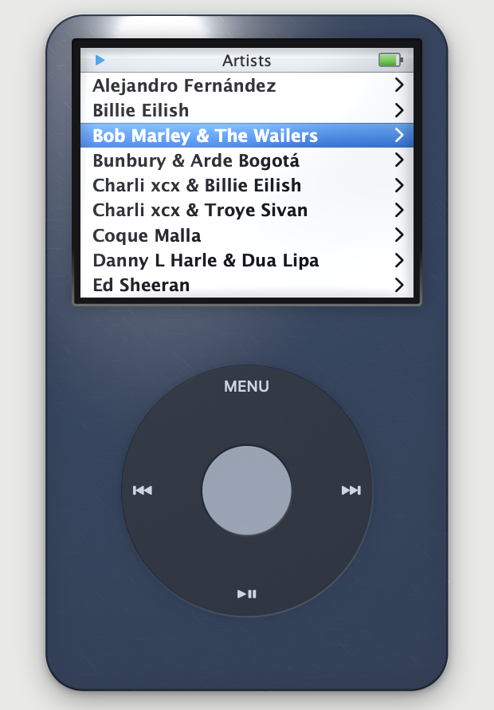
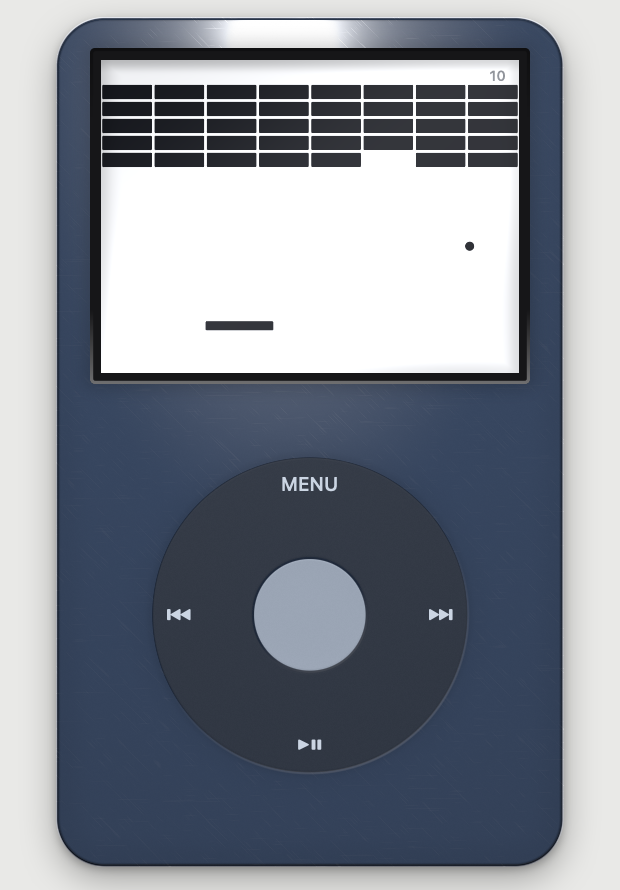

# Clickwheel

### An iPod for your Mac.

Your Apple Music favourites, a working click wheel, and a little bit of 2005 on your desktop.

**[Download for macOS](https://github.com/alexissan/clickwheel/releases/latest)** · [Build from source](#build-from-source) · [Controls](#controls)

macOS 15+ · Apple Silicon and Intel · Free and open source



## Take it for a spin

Browse your favourites, turn up the volume, and sneak in a game of Brick.

[](https://github.com/alexissan/clickwheel/releases/download/v1.1.0/clickwheel-walkthrough.mp4)

[Watch the 24-second walkthrough · MP4](https://github.com/alexissan/clickwheel/releases/download/v1.1.0/clickwheel-walkthrough.mp4)

Six finishes. The selector lives right where it should: **Settings → Style**, inside the iPod.

[](https://github.com/alexissan/clickwheel/releases/download/v1.1.0/clickwheel-styles-demo.mp4)

[Watch all six finishes in 14 seconds · MP4](https://github.com/alexissan/clickwheel/releases/download/v1.1.0/clickwheel-styles-demo.mp4)

## Make it yours

| Classic White | Black | Field | Walnut | Midnight | Champagne |
| :---: | :---: | :---: | :---: | :---: | :---: |
| The original | Glossy graphite | Matte olive | Brown and ivory | Navy and silver | Gold and cream |

Each finish changes the shell, wheel, centre button and printed labels together. Your choice is remembered next time you open the app.

## The familiar details

<p>
  
  
  
</p>

- **A wheel that works.** Drag in a circle or scroll to browse. On Now Playing, the wheel adjusts volume; the centre button arms scrubbing.
- **Your music, in order.** Browse playlists, artists, albums and songs from your favourites, with shuffle and repeat.
- **Feels like the hardware.** Wheel clicks, trackpad haptics, an LCD pixel grid and reflections that move with the room.
- **Made for the desktop.** Actual Size, Float on Top, a battery meter that follows your Mac, and a backlight timer.

## Install

1. [Download the latest DMG](https://github.com/alexissan/clickwheel/releases/latest).
2. Open it and drag **Clickwheel** to **Applications**.
3. Launch Clickwheel and allow it to control **Music.app** when macOS asks.

You’ll need macOS 15 or later and an Apple Music subscription. Star songs in Music.app to make them appear here.

The app and DMG are Developer ID signed. **This release is not notarized by Apple**, so macOS may block the first launch.

## Controls

Drag around the wheel or scroll to move. Click the wheel edges for Menu, Next, Play/Pause and Previous; click the centre to select.

| Key | Action |
| --- | --- |
| ↑ / ↓ | Move through a menu; adjust volume on Now Playing |
| Return / Space / → | Select; arm the scrubber on Now Playing |
| Esc / ← | Back |
| P | Play / pause |
| N / B | Next / previous |
| H | Toggle Hold |

Hold locks the wheel. Press **H** to unlock it.

## Build from source

Install Xcode and its Metal toolchain, then build:

```bash
xcodebuild -downloadComponent MetalToolchain
./Scripts/build_app.sh release
open build/Clickwheel.app
```

Run the navigation and settings tests with `swift test`.

<details>
<summary><strong>Under the shell</strong> — materials, firmware behaviour and the Music.app bridge</summary>

### Materials and dimensions

Every dimension comes from the real device — 103.5 × 61.8 mm, a 38.2 mm wheel centred 72.8 mm down, a 2.5" 320×240 panel — and everything on screen is derived from those millimetres rather than hand-placed. That is what makes **Settings › Actual Size** possible: it reads the display's true physical size from `CGDisplayScreenSize` and renders the iPod life-sized, so it matches a real one held against the screen.

The body has no geometry. SwiftUI's `colorEffect` hands a shader a pixel position and nothing else, so each material reconstructs an implicit surface from a signed distance field, derives a normal from it, and lights that. The edge roll-off, the Fresnel rim, the specular and the moulded well the wheel sits in all fall out of the same field.

The screen is not an impression of the software — it is measured. Apple's October 2005 *Fifth Gen iPod Features Guide* contains genuine 320×240 framebuffer captures, and the menu grid is taken from them: a 24px status bar over nine 24px rows, cap-height-12 semibold type, an 11px text inset, pure white behind it. The numbers self-check — 24 + 9×24 = 240.

And the framebuffer is not the panel. The UI draws against ideal values, then a shader applies what the physical LCD did to them: blacks lifted to a cool dark grey, white that never reaches paper, and the pixel grid of a 160 ppi panel — drawn on the true 320×240 boundaries and faded out at sizes where it could only moiré. When the backlight times out the screen doesn't go dark; it drops to the pale grey-green of a transflective panel running on room light, which is what the real one did. Going dark is what a powered-off device does.

### The firmware details

The wheel does what the 2005 firmware did, not what a 2024 app would guess. On Now Playing it adjusts volume — the bar swaps for the volume bar while it turns — and the centre button arms the scrubber, diamond and all, which reverts to the progress bar after a few idle seconds. Previous restarts the song unless pressed within the first three seconds. Hold locks everything but the key that frees you. The battery mirrors the Mac's own, bolt included while it charges.

Music browses like an iPod, too: Playlists, Artists, Albums and Songs, all drawn from your starred playlist, each level remembering its own selection as you back out.

### Keeping the queue honest

Modern Music.app **drops the playlist context** when you ask it to play a specific track inside a playlist. Playback continues into your whole library instead, so Next and Previous wander off and the iPod's "3 of 182" counter is meaningless.

So Clickwheel owns the queue itself. The backend plays exactly one song and is told not to advance; ordering, shuffle, repeat and the position counter all live in the app, with Music's repeat-one as a guard rail so a late hand-off replays a moment of the same track rather than letting an unrelated one barge in. That also means queue behaviour is identical no matter which backend is underneath.

### The Music.app connection

`MusicSource` is a two-line protocol with one implementation today: a ScriptingBridge connection to Music.app, which runs hidden as the audio engine. Reads are batched with `array(byApplying:)` — one Apple event per property across the whole playlist instead of one per track, which is the difference between 182 songs in **58 ms** and several seconds.

It looks for your starred playlist by name across the locales Apple ships it in, so "Favourite Songs" and "Canciones favoritas" both resolve.

### Source layout

```
Sources/Clickwheel/
  Model/        queue, library, playback protocol
  Sources/      Music.app backend
  Device/       hold, backlight, battery, clicker, haptics
  Navigation/   menu tree
  UI/Body/      shell, click wheel, materials
  UI/Screen/    LCD, laid out in the panel's 320×240 grid
  Shaders/      Metal materials
Sources/MusicBridge/   generated ScriptingBridge interface
```

`Music.h` is generated from Apple's scripting definition rather than committed; the build script produces it on first run.


### Capturing a finish

The app can render its own screenshots without changing your saved style:

```bash
CLICKWHEEL_SNAPSHOT=/tmp/field.png CLICKWHEEL_SNAPSHOT_STYLE=field \
  CLICKWHEEL_SNAPSHOT_SCREEN=styles build/Clickwheel.app/Contents/MacOS/Clickwheel
```

</details>

## Licence

[MIT](LICENSE)
