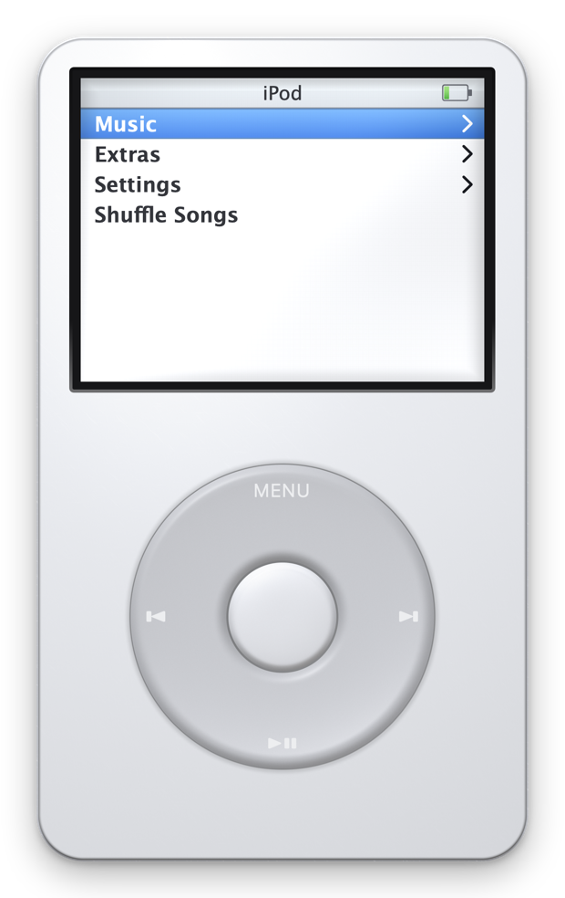
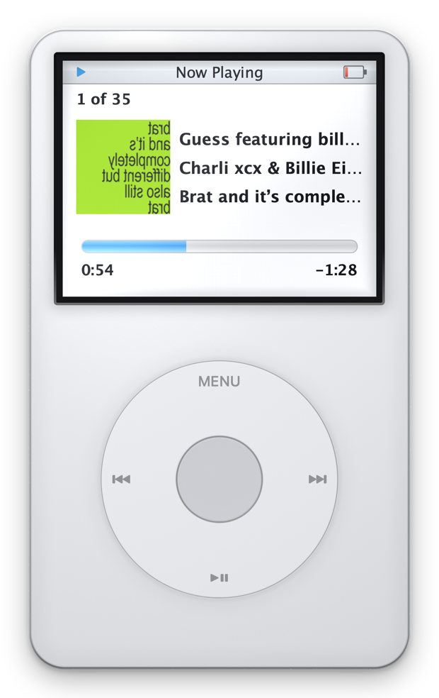
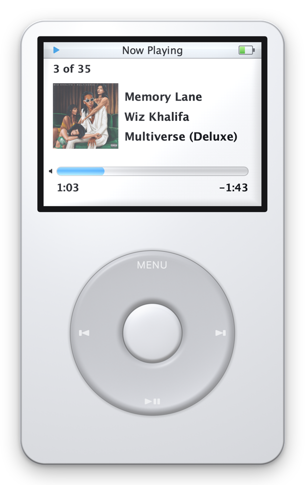
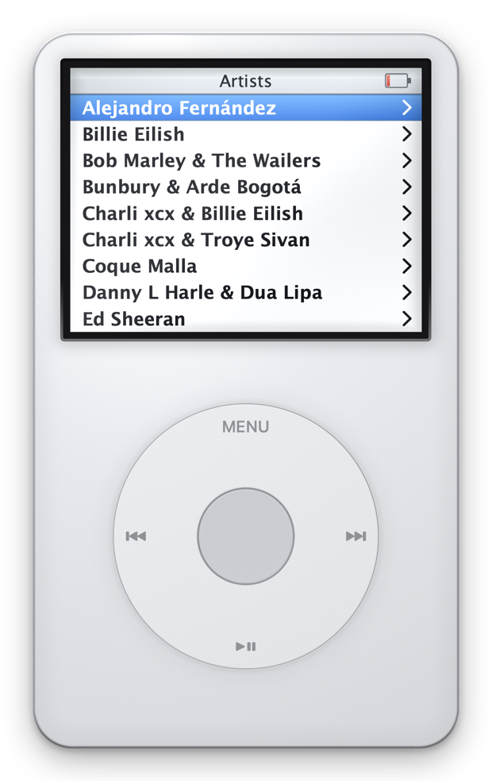
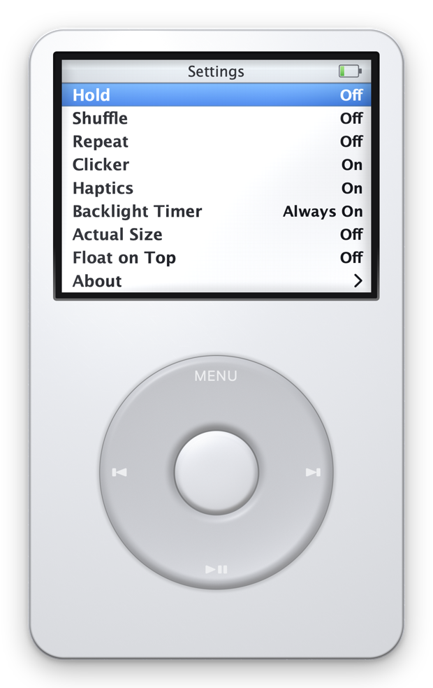

# Clickwheel

A hyperrealistic 5th-generation iPod that lives on your Mac and plays your starred Apple Music songs.

The wheel actually works. Spin it with your thumb, it ticks, and the trackpad taps back.

[Download Clickwheel for macOS](https://github.com/alexissan/clickwheel/releases/latest) · macOS 15+ · Apple Silicon & Intel

Developer ID signed. This release is not notarized by Apple.

<video src="https://github.com/alexissan/clickwheel/releases/download/v1.1.0/clickwheel-styles-demo.mp4" controls width="720"></video>

*Six finishes, selected inside the iPod’s own Settings.*

https://github.com/user-attachments/assets/790ae6d5-335c-4889-b640-62ddf30e9761

*Thirty seconds, recorded by the app itself: `CLICKWHEEL_DEMO=demo.mov` scripts the tour and writes the frames.*



<p>
  
  
  
  
</p>

```bash
./Scripts/build_app.sh release && open build/Clickwheel.app
```

Drag a circle on the wheel or scroll over it · tap the wheel edges for **MENU** / **⏭** / **⏯** / **⏮** · centre to select
On Now Playing the wheel is the **volume**; press the centre button to arm the **scrubber**, exactly like the hardware
Keyboard: **↑ ↓** scroll · **⏎** select · **esc** back · **P** play/pause · **N** / **B** next/back · **H** hold

---

## Device styles

Open **Settings › Style** on the iPod. Turn the wheel or use ↑ / ↓ to choose a
finish, then press the centre button or Return to apply it. The checkmark shows
the active style, and the choice survives relaunching the app.

Classic White · Black · Field (olive and charcoal) · Walnut (brown and ivory) ·
Midnight (navy and silver) · Champagne (gold and cream).

To capture a finish without changing your saved choice:

```bash
CLICKWHEEL_SNAPSHOT=/tmp/field.png CLICKWHEEL_SNAPSHOT_STYLE=field \
  CLICKWHEEL_SNAPSHOT_SCREEN=styles build/Clickwheel.app/Contents/MacOS/Clickwheel
```

## The idea

Every dimension comes from the real device — 103.5 × 61.8 mm, a 38.2 mm wheel centred 72.8 mm down, a 2.5" 320×240 panel — and everything on screen is derived from those millimetres rather than hand-placed. That is what makes **Settings › Actual Size** possible: it reads the display's true physical size from `CGDisplayScreenSize` and renders the iPod life-sized, so it matches a real one held against the screen.

The body has no geometry. SwiftUI's `colorEffect` hands a shader a pixel position and nothing else, so each material reconstructs an implicit surface from a signed distance field, derives a normal from it, and lights that. The edge roll-off, the Fresnel rim, the specular and the moulded well the wheel sits in all fall out of the same field.

The screen is not an impression of the software — it is measured. Apple's October 2005 *Fifth Gen iPod Features Guide* contains genuine 320×240 framebuffer captures, and the menu grid is taken from them: a 24px status bar over nine 24px rows, cap-height-12 semibold type, an 11px text inset, pure white behind it. The numbers self-check — 24 + 9×24 = 240.

And the framebuffer is not the panel. The UI draws against ideal values, then a shader applies what the physical LCD did to them: blacks lifted to a cool dark grey, white that never reaches paper, and the pixel grid of a 160 ppi panel — drawn on the true 320×240 boundaries and faded out at sizes where it could only moiré. When the backlight times out the screen doesn't go dark; it drops to the pale grey-green of a transflective panel running on room light, which is what the real one did. Going dark is what a powered-off device does.

## Faithful behaviour

The wheel does what the 2005 firmware did, not what a 2024 app would guess. On Now Playing it adjusts volume — the bar swaps for the volume bar while it turns — and the centre button arms the scrubber, diamond and all, which reverts to the progress bar after a few idle seconds. Previous restarts the song unless pressed within the first three seconds. Hold locks everything but the key that frees you. The battery mirrors the Mac's own, bolt included while it charges.

Music browses like an iPod, too: Playlists, Artists, Albums and Songs, all drawn from your starred playlist, each level remembering its own selection as you back out.

## The interesting bug

Modern Music.app **drops the playlist context** when you ask it to play a specific track inside a playlist. Playback continues into your whole library instead, so Next and Previous wander off and the iPod's "3 of 182" counter is meaningless.

So Clickwheel owns the queue itself. The backend plays exactly one song and is told not to advance; ordering, shuffle, repeat and the position counter all live in the app, with Music's repeat-one as a guard rail so a late hand-off replays a moment of the same track rather than letting an unrelated one barge in. That also means queue behaviour is identical no matter which backend is underneath.

## How it plays your music

`MusicSource` is a two-line protocol with one implementation today: a ScriptingBridge connection to Music.app, which runs hidden as the audio engine. Reads are batched with `array(byApplying:)` — one Apple event per property across the whole playlist instead of one per track, which is the difference between 182 songs in **58 ms** and several seconds.

It looks for your starred playlist by name across the locales Apple ships it in, so "Favourite Songs" and "Canciones favoritas" both resolve.

## Requirements

macOS 15+, an Apple Music subscription, and Xcode's Metal toolchain:

```bash
xcodebuild -downloadComponent MetalToolchain
```

On first launch macOS asks for permission to control Music.app. Without it the library reads as empty.

## Layout

```
Sources/Clickwheel/
  Model/        queue, library, playback protocol
  Sources/      Music.app backend
  Device/       hold, backlight, battery, clicker, haptics
  Navigation/   menu tree
  UI/Body/      shell, click wheel, materials
  UI/Screen/    LCD, laid out in the panel's 320×240 grid
  Shaders/      Metal materials
Sources/MusicBridge/   generated ScriptingBridge interface
```

`Music.h` is generated from Apple's scripting definition rather than committed; the build script produces it on first run.

## Licence

MIT
